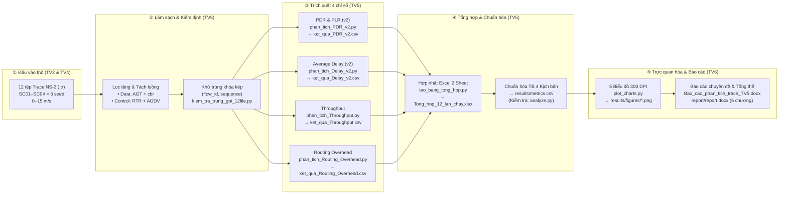
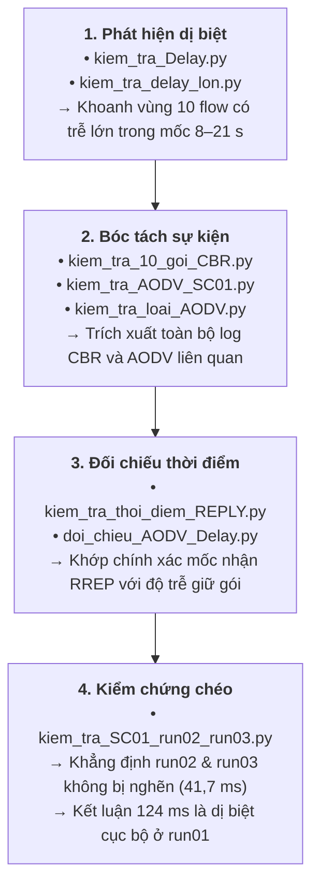

# Mô hình luồng phân tích, làm sạch dữ liệu và xuất kết quả

Tài liệu này hệ thống hóa toàn bộ luồng xử lý dữ liệu thực nghiệm trong đề tài: **"Đánh giá hiệu năng giao thức AODV trong MANET bằng NS-2"**, được tổng hợp từ 21 script trong thư mục `analysis/` và các bảng kết quả trong `results/`.

> 💡 **Xem giao diện tương tác:** Tệp [docs/mo-hinh-luong-du-lieu.html](mo-hinh-luong-du-lieu.html) có thể mở trực tiếp bằng trình duyệt để tra cứu tương tác từng bước và thuật toán lọc của từng script.

---

## 1. Sơ đồ luồng tổng thể (5 giai đoạn)

---

## 2. Sơ đồ nhánh điều tra điểm dị biệt `SC01_run01` (Trễ 124 ms)

Khi phân tích kết quả lượt chạy `SC01_run01` (kịch bản đứng yên $0\text{ m/s}$), độ trễ đầu cuối ghi nhận mức dị biệt $124\text{ ms}$ (so với $\sim 41,7\text{ ms}$ ở 2 lượt còn lại). Thành viên 5 đã thiết lập chuỗi script điều tra chuyên sâu:

---

## 3. Bảng phân loại 21 Script trong `analysis/`

| STT | Nhóm chức năng | Tệp Script Python | Đầu vào | Quy tắc xử lý cốt lõi / Đầu ra | Phụ trách |
| :---: | :--- | :--- | :--- | :--- | :---: |
| 1 | **Kiểm định toàn vẹn** | `kiem_tra_goi_tin.py` | 12 tệp `.tr` | Đếm gói gửi/nhận, kiểm tra gói nhận mồ côi | TV5 |
| 2 | **Kiểm định toàn vẹn** | `kiem_tra_trung_goi.py` | `sc01_run01.tr` | Kiểm tra trùng khóa kép trên 1 tệp thử nghiệm | TV5 |
| 3 | **Kiểm định toàn vẹn** | `kiem_tra_trung_goi_12file.py` | 12 tệp `.tr` | Khẳng định 0 gói trùng gửi/nhận trên toàn bộ 12 tệp | TV5 |
| 4 | **Tính chỉ số (v1 & v2)** | `phan_tich_PDR.py` → `_v2.py` | 12 tệp `.tr` | Lọc `AGT + cbr`, dùng phép giao `sent & received` xuất `ket_qua_PDR_v2.csv` | TV5 |
| 5 | **Tính chỉ số (v1 & v2)** | `phan_tich_Delay.py` → `_v2.py` | 12 tệp `.tr` | Ghép cặp `s-r`, `del sent_time` chống tính trùng xuất `ket_qua_Delay_v2.csv` | TV5 |
| 6 | **Tính chỉ số** | `phan_tich_Throughput.py` | 12 tệp `.tr` | Tính thời gian `last_receive - first_send`, cỡ 512B xuất `ket_qua_Throughput.csv` | TV5 |
| 7 | **Tính chỉ số** | `phan_tich_Routing_Overhead.py` | 12 tệp `.tr` | Bóc tách 4 loại bản tin AODV ở `RTR` xuất `ket_qua_Routing_Overhead.csv` | TV5 |
| 8–14 | **Điều tra dị biệt SC01** | `kiem_tra_Delay.py` `kiem_tra_delay_lon.py` `kiem_tra_10_goi_CBR.py` `kiem_tra_AODV_SC01.py` `kiem_tra_loai_AODV.py` `kiem_tra_thoi_diem_REPLY.py` `doi_chieu_AODV_Delay.py` | `sc01_run01.tr` | Khoanh vùng mốc 8–21 s, đối chiếu 10 luồng CBR trễ cao với thời điểm nhận bản tin AODV REPLY | TV5 |
| 15 | **Kiểm chứng chéo** | `kiem_tra_SC01_run02_run03.py` | `sc01_run02.tr` `sc01_run03.tr` | Đối chiếu top 10 gói trễ lớn nhất trên 2 lượt chạy đối chứng | TV5 |
| 16 | **Tổng hợp bảng** | `tao_bang_tong_hop.py` | 4 CSV kết quả | Hợp nhất dữ liệu xuất `Tong_hop_12_lan_chay.xlsx` (Sheet 1: 12 lượt, Sheet 2: TB kịch bản) | TV5 |
| 17 | **Thống kê dữ liệu** | `analyze.py` | `results/metrics.csv` | Kiểm tra nhanh bảng chỉ số trung bình phục vụ vẽ đồ thị | TV5 / TV6 |
| 18 | **Trực quan hóa** | `plot_charts.py` | `results/metrics.csv` | Xuất 5 biểu đồ 300 DPI vào `results/figures/` | TV6 |
| 19 | **Đo đạc mẫu** | `calculate_metrics.awk` | 1 tệp `.tr` | Script mẫu tính nhanh qua AWK theo khung tham chiếu | TV5 |
